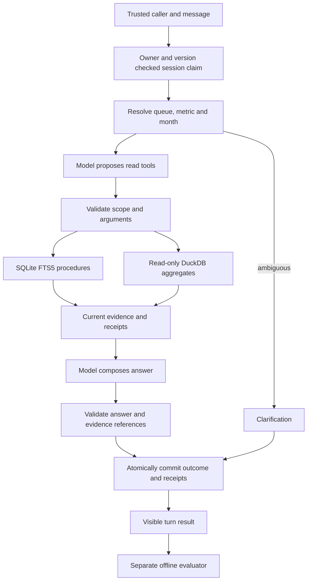

# Architecture

The application answers monthly questions about two synthetic service queues using
versioned procedures and exact daily aggregates. A model selects read tools and
composes answers. Application code owns authority, dates, budgets, and persistence.

## State and authority

The CLI supplies a fixed synthetic caller; it is not an authentication service.
Messages, retrieved documents, stored history, and model output cannot grant queue
access. Every tool call validates the current caller. Session ownership is independent
of queue scope, and historical receipts are checked against current scope on read.

Conversation state resolves references and carries explicit selections. A queue,
month, or metric change invalidates incompatible active evidence. The answer composer
receives current evidence, not prior answers as factual support. The baseline uses
the same tools and model without prior dialogue state.

SQLite stores sessions, append-only turns, immutable receipt payloads, and outcomes.
Inference runs outside write transactions. Short-lived claims prevent concurrent
workers from committing the same session version. See the
[turn-claim decision](adr/0001-bounded-turn-claims.md).

## Data and model boundaries

Procedure search is lexical FTS5, filtered by queue and effective dates. It does not
provide semantic vector retrieval. Analytical queries are two enumerated,
parameterized SQL templates over a read-only DuckDB snapshot. The model cannot submit
SQL, choose database objects, or mutate source data. Missing, conflicting, and
incomplete sources produce visible outcomes rather than invented zero counts.

Ollama serves one digest-pinned local model on the container network. Structured
output has explicit schemas and byte/token/time limits. Calls have no automatic
retry or fallback. Timeouts protect the client and local commit boundary; they do
not guarantee cancellation of inference already running on the server.

## Design choices

| Choice | Reason | Tradeoff |
|---|---|---|
| SQLite sessions | A local CLI needs durable, inspectable version and claim checks without a database service | Single-host writes and availability |
| FTS5 procedure search | Twelve versioned passages fit lexical retrieval with explicit scope/date filters | Semantic paraphrases can be missed; retrieval quality must be measured |
| Approved DuckDB templates | Two known metrics need exact, parameterized reads rather than generated SQL | Supported analytics remain deliberately narrow |
| Separate Ragas image | Evaluation dependencies do not expand the chat runtime | Two container builds and explicit evaluation commands |

## Evaluation boundary

Ragas scores saved outputs after execution. It never authorizes a read or approves
an answer before delivery. Independent labels remain outside agent inputs. Fixture
integrity, scope, numeric results, tool trajectories, faithfulness coverage, and
calibration each answer different questions. See [evaluation](evaluation.md).

This is a single-host, synthetic-data reference. It does not implement external user
authentication, distributed session storage, service availability, or general SQL
generation. Valid citations and numeric-token checks do not prove prose support.
